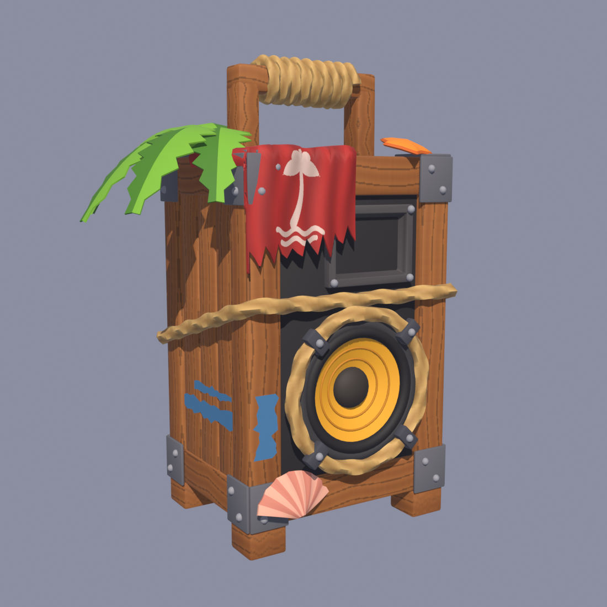
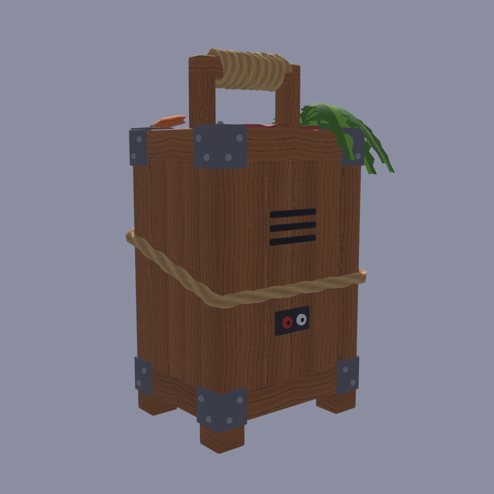

# Колонка для лобби

Деревянная пляжная колонка-ящик: каркас из досок, железные уголки, рупор, оранжевый
динамик в верёвочном кольце, верёвка вокруг корпуса, ручка с обмоткой, красная тряпка
с пальмой, пальмовые листья, морская звезда и ракушка.

## Файлы

| Файл | Что это |
|---|---|
| `LobbySpeaker.fbx` | Модель для импорта в Roblox, текстура внутри файла |
| `LobbySpeaker.blend` | Исходник Blender |
| `LobbySpeaker_atlas.png` | Текстура 1024×1024: дерево, тряпка с пальмой, палитра цветов |
| `build_speaker.py` | Скрипт Blender, который собирает модель: `blender -b -P build_speaker.py` |

## Из чего состоит (4 меша, одна текстура)

| Меш | Треугольники | Что внутри |
|---|---|---|
| `Speaker_Body` | 11 114 | Ящик, уголки, рупор, корзина динамика, ручка, задняя панель |
| `Speaker_Rope` | 10 524 | Все верёвки |
| `Speaker_Decor` | 6 974 | Тряпка, листья, звезда, ракушка, облезлая краска |
| `Speaker_WooferCone` | 2 736 | Конус динамика отдельно: центр в середине круга, его можно качать в бит |

Каждый меш укладывается в лимит Roblox: 20 000 треугольников.

## Импорт в Studio

1. **Import 3D** → `LobbySpeaker.fbx`.
2. Размер в Blender: примерно 15 × 10 × 20 (с листьями), сам ящик 10 × 8, высота с ручкой 20.
   Если в окне импорта колонка вышла другого размера, подгони масштаб.
3. Перед колонки — сторона с динамиком. Если после импорта она отвёрнута, просто поверни модель.
4. Листья и тряпка тонкие: если они просвечивают с изнанки, включи у `Speaker_Decor` DoubleSided.

## Анимация под музыку и VFX

Скрипт: [`src/Lobby/LobbySpeaker.client.lua`](../src/Lobby/LobbySpeaker.client.lua).

- Музыка звучит из колонки: рядом громко, дальше тише (оригинальный Sound глушится, его копия играет из динамика).
- Скрипт по басам находит темп и долю трека и бьёт строго по сетке бита.
- На каждую долю корпус упруго пружинит, конус динамика выталкивает вперёд, из динамика выходит одна басовая волна.
- Раз в два бита всплывает нота ♪ ♫ ♬ ♩; цвет — по ноте, которая сейчас звучит в мелодии.
- В брейке без басов волн нет. Музыку выключили — колонка плавно затихает. Всё на клиенте, у каждого игрока своё.

### Подключение

1. Модель в Workspace называется **`LobbySpeaker`**, внутри меши с именами из FBX
   (`Speaker_Body`, `Speaker_WooferCone`, …). У всех деталей включён **Anchored**.
2. Загрузи через **Asset Manager → Import** пять картинок из `vfx/`:
   `note_eighth.png`, `note_beamed.png`, `note_sixteenth.png`, `note_quarter.png`, `wave_ring.png`.
3. У каждой: правый клик → **Copy Asset ID**, и впиши в `CFG.TEXTURES` в начале скрипта
   (`"rbxassetid://123..."`, порядок подписан в комментариях).
4. Положи скрипт в **StarterPlayerScripts** места лобби.
5. Если колонка не реагирует на музыку — задай модели атрибут `MusicName` (string) с точным
   именем Sound музыки.

Сила качания, упругость, размер волны (`WAVE_SIZE_TO`), частота нот (`NOTE_EVERY`), опережение бита
(`BEAT_LEAD`) и цвета — в таблице `CFG` в начале скрипта.
