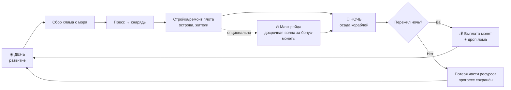
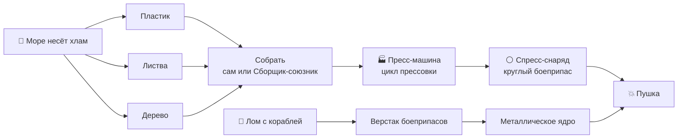

# 🌊 GAME DESIGN BIBLE — «Raft Siege» (рабочее название)

> Полный геймдизайн-документ проекта. Морской survival-tower-defense на плоту.
> Версия 0.1 · обновлён 2026-06-17 · автор-видение: hutsulol
>
> Связанные доки: [`StatsSystem.md`](StatsSystem.md) — каноничная система статов и DNA-прокачки союзников.

---

## 📑 Оглавление

1. [Концепт и столпы](#1-концепт-и-столпы)
2. [Главный игровой цикл (День/Ночь)](#2-главный-игровой-цикл-деньночь)
3. [⭐ Сигнатурный луп: Мусор → Пресс → Снаряд → Пушка](#3--сигнатурный-луп-мусор--пресс--снаряд--пушка)
4. [Враги — корабли с моря](#4-враги--корабли-с-моря)
5. [Оборона плота](#5-оборона-плота)
6. [Острова, жители и пассивный доход](#6-острова-жители-и-пассивный-доход)
7. [Союзники и прогрессия (DNA)](#7-союзники-и-прогрессия-dna)
8. [Экономика и валюты](#8-экономика-и-валюты)
9. [💰 Монетизация (gamepass'ы)](#9--монетизация-gamepassы)
10. [Прогрессия, ретеншн, роадмап](#10-прогрессия-ретеншн-роадмап)
11. [Карта дизайна на код репозитория](#11-карта-дизайна-на-код-репозитория)
12. [Приложение: настраиваемые параметры](#12-приложение-настраиваемые-параметры)
13. [⚖️ Баланс v0.2 — экономика ресурсов и крафта](#13-️-баланс-v02--экономика-ресурсов-и-крафта-реальный-код)
14. [🌙 Дизайн ночей, волн и фракций-кораблей](#14--дизайн-ночей-волн-и-фракций-кораблей)

> ⚠️ Все числа в документе — **стартовые значения для балансировки**, а не финальные. Помечены как «(tune)».

---

## 1. Концепт и столпы

**Логлайн:** Ты выживаешь на плоту посреди враждебного моря. Днём собираешь хлам, прессуешь его в боеприпасы и строишь крепость; ночью корабли-налётчики осаждают твой плот, и ты отбиваешься из пушек. Освобождаешь жителей с островов и даёшь им работу, чтобы плот рос даже пока ты спишь.

**Жанр:** Survival + Tower-Defense (баланс 50/50) на плоту, кооп-friendly.

**Три столпа (равновесие 50/50):**

| Столп | Что это | Базовые системы |
|---|---|---|
| 🛡️ **Оборона** | Корабли атакуют ночью; пушки, боеприпасы, фортификация, абордаж | пушки, тиры кораблей, осада |
| 🔨 **Развитие** | Сбор хлама, пресс, крафт, расширение/ремонт плота | пресс-луп, building, crafting |
| 🏝️ **Экспансия** | Острова, освобождение жителей, раздача работ → пассивный доход | острова, villagers, союзники |

**Фантазия игрока:** «Мой плот — это крепость и фабрика. Я превращаю мусор в пушечные ядра и держу оборону против всего моря, а спасённая команда работает на меня».

**Дизайн-принцип монетизации:** F2P-игрок **должен** уметь пережить ночь и прогрессировать. Донат (gamepass'ы) даёт **удобство и масштаб**, но не ломает PvE-баланс. См. [раздел 9](#9--монетизация-gamepassы).

**Целевая аудитория:** Roblox, 9–16 лет, любители Raft / Tower Defense / base-building.

---

## 2. Главный игровой цикл (День/Ночь)

Игра построена на чередовании **дня (развитие)** и **ночи (оборона)**. Это даёт честный ритм 50/50 и переиспользует существующий `DayNightCircle.server.lua`.



**Длительности (tune):**

| Фаза | Длина | Что происходит |
|---|---|---|
| ☀️ День | ~6 мин | Сбор, пресс, стройка, острова. Спокойно, но не «полностью пусто» — редкий одиночный T1-разведчик. |
| 🌙 Ночь | ~3 мин | 2–5 волн кораблей (по уровню осады). Активная оборона. |
| 🌅 Рассвет | выплата | Подсчёт монет за потопленные корабли, авто-ремонт даёт пауза. |

**Маяк рейда (из подхода «управляемая угроза»):** в фазе дня игрок может активировать **Маяк** и вызвать внеплановую волну прямо сейчас. Награда — повышенный дроп монет (×1.5, tune). Для игроков, которым скучно ждать ночь. Привязать к взаимодействию у `AnchorInteraction` / отдельному объекту на плоту.

**Уровень осады (Siege Level):** растёт с прогрессом игрока (размер плота + кол-во пушек + ночей пережито). Определяет кол-во волн, тиры кораблей и их HP. Не даёт «перерасти» угрозу — оборона остаётся вызовом.

> 🔧 **Технический инвариант (важно!):** плот **реально плывёт вперёд** — `BoatMovement.server.lua` задаёт `SPEED = 8` студ/с по носу с поворотом по ветру (`TURN_SPEED`), кастомная плавучесть держит его на `waterY`. «Плавание» настоящее: корабли и острова появляются **по курсу и вокруг** плывущего плота. **Жёсткое правило:** никогда не ставить `Anchored = true` и не двигать `CFrame` у **приваренной к плоту** части **на клиенте** — это морозит всю сварную сборку (сервер двигает плот → рассинхрон; это был баг `Gui22Bob`). Новые приваренные парты наследуют коллиз-группу `Raft` + `SetNetworkOwner(nil)`. Плавающий хлам живёт в группе `FloatingResource`, чтобы дрейфовать мимо плота и игроков, не толкая их.

---

## 3. ⭐ Сигнатурный луп: Мусор → Пресс → Снаряд → Пушка

Это **уникальная механика игры** и ядро столпа «Развитие→Оборона». Превращаем мусор из моря в боеприпасы.



### 3.1 Хлам (входной ресурс)

Три вида плавающего хлама дрейфуют мимо плота (реюз дрейфа `FloatingResource` + спавн через `ResourceSpawner.server.lua`):

| Хлам | Где | Иконка-идея |
|---|---|---|
| 🧴 Пластик | дрейфует по поверхности | бутылки/канистры |
| 🍃 Листва | дрейфует | пучки водорослей/листьев |
| 🪵 Дерево | дрейфует | доски/коряги |

Сбор: игрок вручную (реюз `ResourcePull.client`) или союзник в режиме **«Сборщик»** (см. [раздел 6](#6-острова-жители-и-пассивный-доход)).

### 3.2 Пресс-машина

Стоит на плоту **с начала игры** (стартовая постройка). Работает как печь (`FurnaceCraft`/`FurnaceUI` как образец UI/логики):

- **Вход:** 3 ед. хлама (любой микс) → **1 спресс-снаряд** (tune).
- **Цикл прессовки:** ~8 сек (tune). Очередь на несколько снарядов.
- Готовые снаряды копятся в **складе боеприпасов** на плоту.
- Апгрейды пресса (за монеты): объём очереди, скорость цикла.

### 3.3 Тиры боеприпасов

Глубина прогрессии: чем дальше игрок, тем мощнее снаряды.

| Снаряд | Из чего | Урон (tune) | Особенность |
|---|---|---|---|
| ⚪ **Спресс-снаряд** | 3 хлам (микс) | 25 | базовый, мини-AoE |
| 🔩 **Металлическое ядро** | 2 лом + 1 спресс | 60 | пробивает броню T3+ |
| 💣 **Взрывной снаряд** | 1 редкая находка + 2 лом | 120 (AoE) | бьёт по группе кораблей |

Лом (🔩) падает с потопленных кораблей — так **оборона кормит развитие**, замыкая петлю: топишь корабли → получаешь лом → крафтишь снаряды получше → топишь больше.

### 3.4 Заряжание и стрельба

- Снаряд заряжается в пушку (реюз `CanonSystem.server.lua` / `CanonPlacer.client.lua`, паттерн `FireGun.server.lua` из модели `Pirate ship`).
- **Ручной режим:** игрок садится за пушку, целится мышью, стреляет.
- **Авто-подача:** gamepass «Авто-заряжание» берёт снаряды со склада без ручного клика (см. [раздел 9](#9--монетизация-gamepassы)).

---

## 4. Враги — корабли с моря

Злые корабли появляются по курсу и вокруг плывущего плота, разных размеров и силы.

### 4.1 Тиры кораблей (стартовый баланс — tune)

| Тир | Корабль | HP | Монеты | Абордаж | Урон по плоту | Поведение |
|---|---|---|---|---|---|---|
| T1 | 🛶 Лодка | 60 | 10–20 | 1 | низкий | быстрая, таранит край |
| T2 | ⛵ Шлюп | 150 | 30–50 | 2 | лёгкий залп | держит среднюю дистанцию |
| T3 | 🚢 Бриг | 350 | 80–120 | 3 | средний залп | бомбардировка + абордаж |
| T4 | 🏴‍☠️ Галеон | 800 | 200–300 | 5 | тяжёлая бомбардировка | медленный, опасный |
| 👑 BOSS | 💀 Дредноут / Флагман корсаров | 3000 | 1000+ | 8 | всё сразу | раз в N ночей (tune), большой пэйаут |

Размер модели визуально растёт с тиром. Реюз моделей `Pirate ship`, `Corsair`, `Corsair_skull`.

### 4.2 Дроп при разрушении

- 💰 **Монеты** — всегда (главная валюта, см. [раздел 8](#8-экономика-и-валюты)).
- 🔩 **Лом-металл** — на боеприпасы T2/T3 и апгрейды.
- 🎁 **Редкий дроп** (шанс): ящик с ресурсами, чертёж апгрейда, скин-токен, редкая находка для взрывных снарядов.

### 4.3 Паттерны атаки (как корабли атакуют плот)

1. **🎯 Бомбардировка (дистанция):** корабль встаёт на дистанции и стреляет ядрами по плоту. Ядра **повреждают тайлы/постройки/пушки** (HP-объекты через `DestructibleSystem.server.lua`). Цель — выбить пушки и пробить к Ядру.
2. **⚔️ Абордаж (вплотную):** корабль подходит к краю и **высаживает пиратов** на плот (реюз AI `Corsair`/`Pirate lvl1`/`Pirate_2`, спавн как `PirateSpawns.server.lua`). Их нужно бить в ближнем бою (игрок + союзники-бойцы). Абордажники ломают постройки и атакуют игрока/команду.
3. **💢 Таран (T1):** мелкие быстрые лодки разгоняются и бьют край плота, откалывая тайлы.

### 4.4 Реакция игрока на каждую атаку

| Атака | Контрмера |
|---|---|
| Бомбардировка | Потопить корабль пушками **до** того, как он разнесёт оборону; чинить тайлы; ставить стены-щиты. |
| Абордаж | Ближний бой (игрок + союзники-бойцы в режиме «Бой»); стены замедляют высадку. |
| Таран | Укреплённые края (двойные стены), приоритетный отстрел быстрых лодок. |

---

## 5. Оборона плота

### 5.1 Пушки

- **Стартовая пушка** стоит на плоту с начала игры.
- Игрок **ставит новые пушки** за монеты (реюз `CanonPlacer.client.lua`) в слоты по краю плота.
- **Ручное прицеливание:** садишься за пушку → целишься → стреляешь (основной экшен ночи).
- **Союзник-канонир:** режим «Канонир» — авто-стрельба по ближайшему кораблю (статы Удача/Скорость влияют на точность/скорострельность, см. [`StatsSystem.md`](StatsSystem.md)).
- Апгрейды пушки (монеты): урон, дальность, скорострельность, поворотность.

### 5.2 Фортификация

- **Стены/баррикады** по краю плота (реюз building, модель `wall_model_wood_with_window`): блокируют абордаж, поглощают урон бомбардировки.
- **Ремонт:** повреждённые тайлы/постройки чинятся за дерево/лом днём.

### 5.3 Ставка и условие проигрыша ночи

- У плота есть **Ядро (Штурвал/Сердце плота)** — ключевой объект.
- Если ночью корабли/абордажники **разрушат Ядро** → ночь проиграна: теряешь часть запаса ресурсов/снарядов (tune), плот «потрёпан».
- **Постоянный прогресс не теряется** (`RaftSaveSystem.server.lua` сохраняет плот, апгрейды, союзников, монеты). Это soft-fail, не «вайп» — важно для удержания.

---

## 6. Острова, жители и пассивный доход

Столп «Экспансия». Реализует «освобождаешь жителей и даёшь им работу → пассивные ресурсы».

### 6.1 Острова

- Острова появляются по курсу плывущего плота (`WorldEventSpawner.server.lua`, дуга 180° спереди, далеко на горизонте); когда остров входит в радиус — игрок взаимодействует (зачистка/освобождение).
- На острове — **враги** (пираты/заражённые) и **клетки с жителями**.
- Зачистка острова (`IslandClearSystem.server.lua`) открывает доступ к клеткам.

### 6.2 Освобождение жителей

- Освобождаешь жителя (реюз `Villagers` / `VillagersHUD.client.lua`) → он становится **союзником** твоей команды.
- У жителя есть тип/статы (привязка к [`StatsSystem.md`](StatsSystem.md): Пират → Мародёр → Мутант → Военный → Прототип).

### 6.3 Работы (пассивный доход)

Каждому союзнику назначаешь работу через **Телефон** (ally-management UI: `Phone_Menu` / `PhoneMenu`):

| Работа | Пассивный выход | Ключевой стат |
|---|---|---|
| 🪓 Лесоруб | дерево/мин | Скорость |
| 🔩 Сборщик лома | лом/мин | Скорость |
| 🎣 Рыбак | рыба + шанс редкой находки | Удача |
| 🌊 Гатерер (хлам) | хлам/мин (авто-кормит пресс) | Скорость |
| 💥 Канонир | стоит у пушки ночью | Удача/Скорость |
| ⚔️ Боец | бьёт абордажников | Сила |
| 😴 Простой | не ест, копит «энергию» | — |

- Пассивный выход масштабируется **со статами** (формулы Speed/Luck → время в [`StatsSystem.md`](StatsSystem.md)) и **уровнем работы**.
- Союзники едят (привязка к `FoodSystem`/`HungerSystem`) — расход на содержание команды как ресурсный sink.

---

## 7. Союзники и прогрессия (DNA)

Полностью переиспользуем уже спроектированную систему из [`StatsSystem.md`](StatsSystem.md):

- **3 стата:** 💪 Сила (урон) · ⚡ Скорость (время сбора) · 🎲 Удача (рыбалка/редкий дроп).
- **Тиры NPC:** Пират(10) → Мародёр → Мутант → Военный → Прототип(180+). Высший тир базово сильнее макснутого низшего.
- **DNA-прокачка:** убийство NPC данного типа → образец DNA → анализ в Лаборатории → DNA-очки → уровни (L1–L10).
- **Tier-cap:** число убийств ограничивает доступный максимум уровня.
- **Режимы союзника** расширены под эту игру: Бой / Сбор / Рыбалка / Канонир / Гатерер / Охрана / Простой.

> Эта система — каноничная. Боевые/рабочие союзники в разделах 5–6 берут статы и формулы отсюда. Реюз кода: `MercStats.lua`, `Mercenarys`, `dna&blood system`.

---

## 8. Экономика и валюты

### 8.1 Валюты и ресурсы

| Тип | Что | Источник | Куда тратится |
|---|---|---|---|
| 💰 **Монеты** (soft) | главная игровая валюта | потопленные корабли, маяк-рейды | пушки, апгрейды, рецепты, найм/содержание |
| 🧴🍃🪵 **Хлам** | сырьё боеприпасов | дрейф моря, Гатереры | пресс → снаряды |
| 🔩 **Лом** | сырьё T2/T3 снарядов и апгрейдов | дроп кораблей, Сборщики | верстак боеприпасов, ремонт |
| 🪵🪨 **Дерево/Камень** | стройка/ремонт | острова, фермы, дрейф | плот, стены, постройки |
| 🍗 **Еда** | содержание команды | рыбалка, фермы (`GardenSystem`, `FoodSystem`) | кормёжка союзников |
| 💎 **Robux** | реальная валюта | покупка | gamepass'ы (см. ниже) |

### 8.2 Петли экономики

- **Боевая петля:** корабли → монеты + лом → снаряды/пушки → топишь больше кораблей.
- **Экспансия-петля:** острова → жители → работы → пассивные ресурсы → больше плот/снарядов → дальше острова.
- **Sink'и (куда уходят ресурсы, чтобы экономика не переполнялась):** апгрейды пушек/пресса, ремонт после ночей, содержание команды (еда), расширение плота.

### 8.3 Кривая монет (стартовая — tune)

| Покупка | Цена (монеты) |
|---|---|
| Новая пушка | 150 |
| Апгрейд пушки L1→L2→L3 | 300 / 700 / 1500 |
| Открыть рецепт «Металлическое ядро» | 500 (разово) |
| Открыть рецепт «Взрывной снаряд» | 2000 (разово) |
| Расширение плота (тайл-секция) | 100 × множитель размера |
| Апгрейд пресса | 400 / 900 |

---

## 9. 💰 Монетизация (gamepass'ы)

Монетизация построена на **gamepass'ах (разовая покупка за Robux)** — выбор по итогам брейнсторминга. Принцип: **удобство и масштаб, не сырая сила**, F2P остаётся проходимым.

### 9.1 Основные gamepass'ы (цены — tune, в Robux)

| # | Gamepass | Что даёт | Ценность для игрока | R$ (tune) |
|---|---|---|---|---|
| 1 | 🔁 **Авто-заряжание** | пушки сами берут снаряды со склада | убирает рутину клика ночью | 199 |
| 2 | 💰 **x2 Монеты** | двойной дроп монет с кораблей | быстрее прогресс | 299 |
| 3 | 🔫 **Доп. слоты пушек** | +2 (или +4) слота под пушки | мощнее оборона | 149 / 249 |
| 4 | 🏗️ **Больше плота** | выше лимит построек/тайлов | масштаб базы | 199 |
| 5 | 🏝️ **VIP-остров** | доп. слот острова + быстрее пассивный доход | сильнее экспансия | 249 |
| 6 | ⚙️ **Мастер-пресс** | пресс работает ×2 / мгновенно | больше снарядов | 149 |
| 7 | 🧲 **Морской магнит** | авто-сбор хлама в радиусе вокруг плота | убирает рутину сбора | 199 |

### 9.2 Опциональные dev-products (расходники за Robux) — вторично

- 💰 Пак монет (S/M/L)
- 🛠️ Мгновенный ремонт плота
- 📦 Ящик снарядов
- ⚡ Ускоритель пассивного дохода (на сессию)

### 9.3 Существующий канал — gacha-яйцо (опционально)

В коде уже есть `EggCaseUI.client.lua` («Приключенское яйцо», 5 редкостей). Может остаться **вторичным косметик/юнит-каналом**, но по итогам обсуждения **основной фокус доната — gamepass'ы выше**. Если позже захотим премиум-валюту — яйцо легко подключить.

### 9.4 Анти-P2W правила (обязательно)

- Ни один gamepass не даёт урона/HP, недоступного F2P-игроку через прогресс.
- x2 Монеты ускоряет, но не «открывает» контент.
- Боевой баланс ночей считается **от F2P-возможностей**; донат = comfort/scale.

---

## 10. Прогрессия, ретеншн, роадмап

### 10.1 Дуга игрока

| Этап | Плот | Оборона | Угроза | Экспансия |
|---|---|---|---|---|
| 🐣 Старт | 1 пушка, мелкий плот | ручная стрельба | T1 ночью | — учимся прессу |
| 📈 Середина | несколько пушек, стены | союзники-канониры, ядра-снаряды | T2–T3, первые боссы | 1–2 острова, первые работы |
| 🏰 Поздняя | крепость-плот, крю | авто-подача, взрывные снаряды | T4 + Дредноуты | сеть островов, пассив-экономика |

### 10.2 Ретеншн-крючки

- **Дейлики:** первая ночь дня, маяк-баунти, заход на остров.
- **Босс-ивенты:** Дредноут раз в N ночей с большим пэйаутом.
- **Долгосрочка:** прокачка всей команды до Прототипов, полный апгрейд пушек, «крепость мечты».
- **Онбординг:** реюз `Onboarding` / `Quests` / `Story` для обучения лупу пресс→пушка в первые минуты.

### 10.3 Метрики успеха (ориентиры)

- D1 ≥ 30%, D7 ≥ 10% (Roblox-нормы для жанра).
- Конверсия в платящих 2–5%; основной драйвер — «Авто-заряжание» и «x2 Монеты».
- Средняя сессия 12–20 мин (2–3 цикла день/ночь).

### 10.4 Роадмап реализации

| Приоритет | Что | Статус в коде |
|---|---|---|
| P0 | Пресс-луп (хлам→пресс→снаряд), склад боеприпасов | 🟡 частично (`ResourceSpawner`, `PlasticContainerSystem`, пресс — новый) |
| P0 | Ночная осада + волны + тиры кораблей | 🟡 частично (модели/AI есть, волновой менеджер — новый) |
| P0 | Урон по плоту + ремонт + Ядро | 🟡 частично (`DestructibleSystem`) |
| P1 | Монеты-экономика + магазин апгрейдов | 🔴 новое |
| P1 | Маяк рейда | 🔴 новое |
| P1 | Работы жителей → пассив | 🟡 частично (`Villagers`, `StatsSystem`) |
| P2 | Gamepass'ы (7 шт.) | 🔴 новое |
| P2 | Тиры боеприпасов (лом/взрывные) | 🔴 новое |
| P3 | Боссы-Дредноуты, ивенты | 🔴 новое |

✅ Уже есть фундамент: пушки, дрейф мира, острова, DNA-союзники, день/ночь, building, crafting, survival-системы.

---

## 11. Карта дизайна на код репозитория

| Система GDD | Файл / папка в репо | Действие |
|---|---|---|
| Цикл день/ночь | `ServerScriptService/DayNightCircle.server.lua` | хук фаз, триггер ночи |
| Движение плота | `ServerScriptService/BoatMovement.server.lua` | `SPEED=8` вперёд + поворот по ветру; `FloatingResource` дрейфует мимо; **не якорить приваренные парты на клиенте** |
| Спавн хлама | `ServerScriptService/ResourceSpawner.server.lua` | пластик/листва/дерево |
| Сбор хлама | `StarterPlayerScripts/ResourcePull.client.client.lua` | ручной подбор |
| Пресс-машина | образец `FurnaceCraft.server.lua` / `FurnaceUI.client.lua` | **новый** `CompactorSystem` |
| Пушки | `CanonSystem.server.lua`, `CanonPlacer.client.lua` | стрельба/расстановка |
| Стрельба-паттерн | `ReplicatedStorage/Pirate ship/.../FireGun.server.lua` | референс баллистики |
| Корабли/AI | `ReplicatedStorage/{Corsair,Pirate lvl1,Pirate_2,Pirate ship}`, `PirateSpawns.server.lua` | тиры + волновой менеджер (**новый**) |
| Урон по постройкам | `DestructibleSystem.server.lua` / `DestructibleClient.client.lua` | HP тайлов/пушек, Ядро |
| Стройка/стены | `BuildingSystem.server.server.lua`, `wall_model_wood_with_window` | фортификация |
| Сохранение | `RaftSaveSystem.server.lua` | плот, апгрейды, монеты, команда |
| Острова / события | `WorldEventSpawner.server.lua` (острова + Radiation_event), `IslandClearSystem.server.lua` | спавн/зачистка |
| Жители | `ServerScriptService/Villagers`, `VillagersHUD.client.lua` | освобождение |
| Союзники/статы/DNA | [`StatsSystem.md`](StatsSystem.md), `MercStats.lua`, `Mercenarys`, `dna&blood system` | прогрессия |
| Ally-UI (Телефон) | `ServerScriptService/Phone_Menu`, `StarterPlayerScripts/PhoneMenu` | назначение работ/режимов |
| Маяк рейда | `AnchorInteraction.server.lua` (референс взаимодействия) | **новый** объект-триггер |
| Уведомления | `NotificationCenter.client.lua` | «Ночь близко», «Корабль потоплен» |
| Gacha (вторично) | `EggCaseUI.client.lua` | опц. косметик-канал |
| Survival | `Hunger/Thirst/Food/Radiaton System` | содержание команды, фон |

---

## 12. Приложение: настраиваемые параметры

Единая таблица «ручек» для балансировки (стартовые значения):

```lua
-- ЦИКЛ
DAY_LENGTH      = 360   -- сек
NIGHT_LENGTH    = 180   -- сек
WAVES_PER_NIGHT = {min = 2, max = 5}   -- по Siege Level
BEACON_COIN_MULT = 1.5

-- ПРЕСС
COMPACT_INPUT   = 3     -- ед. хлама на 1 снаряд
COMPACT_TIME    = 8     -- сек цикл
COMPACT_QUEUE   = 5

-- БОЕПРИПАСЫ (урон)
AMMO = {
  pressed   = {dmg = 25,  cost = {junk = 3}},
  metal     = {dmg = 60,  cost = {scrap = 2, pressed = 1}},
  explosive = {dmg = 120, aoe = true, cost = {rare = 1, scrap = 2}},
}

-- КОРАБЛИ {hp, coins{min,max}, boarders}
SHIPS = {
  T1 = {hp = 60,   coins = {10,20},   boarders = 1},
  T2 = {hp = 150,  coins = {30,50},   boarders = 2},
  T3 = {hp = 350,  coins = {80,120},  boarders = 3},
  T4 = {hp = 800,  coins = {200,300}, boarders = 5},
  BOSS = {hp = 3000, coins = {1000,1500}, boarders = 8, everyNights = 5},
}

-- МАГАЗИН (монеты)
SHOP = {
  cannon = 150,
  cannonUpgrade = {300, 700, 1500},
  recipeMetal = 500,
  recipeExplosive = 2000,
  raftSection = 100,   -- × множитель размера
  pressUpgrade = {400, 900},
}

-- GAMEPASS (Robux)
GAMEPASS = {
  autoLoader = 199,
  doubleCoins = 299,
  cannonSlots = 149,
  biggerRaft = 199,
  vipIsland = 249,
  masterPress = 149,
  seaMagnet = 199,
}
```

---

*Документ описывает видение. Каждая система выше — кандидат на отдельный implementation-план (spec → plan → код). Числа балансируются плейтестами.*

---

## 13. ⚖️ Баланс v0.2 — экономика ресурсов и крафта (реальный код)

> Обновлено 2026-07-07. Пройден **полный ревью реального кода** игры (крафты, спавн,
> рулетка, стартовый набор, все sink'и). Раздел описывает **фактические** значения и их
> изменение под цель: **ресурсы добываются медленно, игра идёт «на грани» — не легко, но
> честно и интересно.** ✅ = уже применено в коде, 📝 = дизайн-намерение (ещё не в коде).

### 13.1 Принцип

Днём море подаёт хлам **скупо**, дерево — основной, но не бесконечный ресурс; острова и
дайверы дают сырьё **редкими порциями**. Каждый крафт стоит ощутимо, чтобы игрок выбирал,
на что тратить, а не заваливался ресурсами. Пушки **не крафтятся** — они приходят с рулетки
после волн; патроны — тоже добыча с волн (📝).

### 13.2 Стартовый набор ✅

- Игрок спавнится **только с `Pirate_Gun`** (единственный тул в `StarterPack` → авто-выдача
  движком). Никаких стартовых ресурсов/тулов больше не выдаётся (подтверждено ревью — нет ни
  одного `GiveTool`/`AddResource` на вход). `BackPackPickup` лишь ставит атрибут `HasBackpack`.
- Дальше игрок сам добывает хлам в море как можно быстрее — это и есть напряжение первых минут.

### 13.3 Спавн ресурсов (замедлен) ✅

Пассивные источники раздували мир — это чинилось прямо в коде (все три имели пометку «TEST value»):

| Источник | Файл | Было | Стало | Эффект |
|---|---|---|---|---|
| Дрейф моря (хлам) | `ResourceSpawner.server.lua` | цикл 3с, Дерево+Листва каждый цикл (~40 объектов/мин) | цикл **7с**, Дерево каждый цикл, Листва ×½, Пластик ×¼ (`DRIFT_INTERVAL/LEAVES_EVERY/PLASTIC_EVERY`) | ~**2.5× меньше** мусора; дерево ~8.5/мин, листва ~4/мин |
| Ящики дайвера | `DiverSystem.server.lua` `DELIVERY_INTERVAL` | 15с (тест) | **60с** (боевое) | ~**4× реже** крейты сырья |
| Спавн островов | `WorldEventSpawner.server.lua` `ISLAND_INTERVAL` | 60с (тест) | **180с** (боевое) | реже узлы для добычи |

Активная добыча (кирка/топор/лопата/рыбалка) — **player-gated и уже сбалансирована** (по 5 ударов,
дроп-шансы), её не трогаем: это «пулл», а не «пуш».

### 13.4 Рулетка наград (после волны) ✅ + 📝

- 📝 **Триггер:** по задумке рулетка крутится **после прохождения волны** (сейчас — ручная
  кнопка-подарок; `DayCount` в `ReplicatedStorage` уже есть для привязки).
- ✅ **ПВО (Deffender) убрана из пула** — её шанс (30) ушёл в **обычную Пушку** (45 → **75**),
  а не размазан по редким пушкам. Из рулетки выпадает **всё, кроме ПВО**.
- ✅ **День 1 = 100% базовая Пушка** (`DayCount ≤ 1` → всегда `Cannon`), чтобы новичок
  гарантированно получил рабочую пушку.
- **День 2+ веса:** Пушка 75 / Магма-пушка 18 / Большая магма-пушка 7.
- Файл: `RewardRoll.client.lua` (`ITEMS`, `spin`). Пушки **не крафтятся** — только отсюда.

### 13.5 Патроны (📝 — намерение)

- Сейчас `Pirate_Gun` даёт `Ammo=3` + `ReserveAmmo=9` на спавн и **пополнить их нечем** —
  ни пикапа, ни ящика, ни награды с волны (`BackendScript.server.lua`).
- 📝 **План:** патроны — награда за прохождение волны (ящик патронов в дропе/руле после боя).
  Требует нового пути «волна → патроны» (не реализовано, вынесено отдельной задачей).

### 13.6 Стоимость крафта (адекватные цены)

Ревью нашёл **кластер заглушек `{Log=1}`** (Hammer, Machete, Sawmill, SmallContainer, Anchor,
FireCamp, Phone, Injector, EmptyCapsule, Cannon-стаб) — цена не отражала сложность. Ниже —
целевые цены. Сырьё: Log, Leaves, Plastic, Stone, Sand, Clay, Iron_Ore. Промежуточные: **Rope**
(4 Leaves), **Iron_Ingot** (плавка Iron_Ore + 4 Log топливо), **Wet_Brick** (2 Sand + 2 Clay).

| Предмет | Файл (сервер) | Было | **Стало** | Зачем |
|---|---|---|---|---|
| Hammer (двигает всю стройку) | `InventoryCrafting` | 1 Log | **4 Log** | базовый, но не даром |
| WorkBench | `InventoryCrafting` | 3 Log | **5 Log** | открывает верстак |
| FireCamp | `InventoryCrafting` | 1 Log | **4 Log + 2 Leaves** | готовка |
| Machete (ближний бой) | `InventoryCrafting` | 1 Log | **3 Log + 1 Rope** | оружие |
| Phone (управление командой) | `InventoryCrafting` | 1 Log | **3 Log + 2 Plastic** | девайс |
| Pick-Axe | `PickAxeSystem` | 2 Log | **3 Log + 2 Stone** | добыча камня/руды |
| SmallContainer | `CraftingSystem` | 1 Log | **6 Log** | склад |
| Sawmill | `CraftingSystem` | 1 Log | **6 Log + 4 Stone** | (нужна реализация Log→Plank) |
| Anchor_part (стоп плота) | `CraftingSystem` | 1 Log | **5 Log + 2 Stone** | важный объект |
| Bed (респавн) | `BedCrafting` | 2 Log | **5 Log + 3 Leaves** | точка возрождения |
| **EmptyCapsule** (DNA) | `InventoryCrafting` | 1 Log | **2 Log + 1 Iron_Ingot** | **сток железа** |
| **Injector** (DNA) | `InventoryCrafting` | 1 Log | **3 Log + 1 Iron_Ingot** | **сток железа** |
| Cannon-стаб | `CraftingSystem` | 1 Log | **убрать/скрыть** | пушки только с рулетки |
| Монолит (репар) | `MonolithRepair` | 5 Log + 5 Leaves | **8 Log + 8 Leaves** | ранняя цель |

**Оставлены как есть (уже адекватны):** Rope 4 Leaves · Cup 2 Plastic · PlasticContainer 5 Plastic ·
Wood_Knife 2 Log · Furnace 10 Stone + 5 Log · Stone_Axe 1 Log + 3 Stone + 1 Rope · Shovel 3 Stone +
1 Log + 1 Rope · FishingRod 3 Log + 2 Rope · bag/leaf/Sand-bag 5 Leaves · Wet_Brick 2 Sand + 2 Clay ·
стройка (RAFT 2, BEAM 1, WALL 3, DOOR 2 Log).

> ⚠️ **Важно про синк цен:** серверные таблицы рецептов — авторитетны (списывают ресурс), но
> **клиентские зеркала** (`WorckbenchUI.client.lua`, `InventoryUI.client.lua`) дублируют цену для
> отображения и уже местами расходятся. При правке цены править **оба** места, иначе меню покажет
> не то, что спишется.

### 13.7 Проблемы экономики, вскрытые ревью (to-fix)

- 🔴 **Iron_Ingot — тупик:** его ничто не потребляло (падал с дайверов, плавился) — теперь даём
  сток через DNA-капсулы (13.6). Дальше — «усиленные стены»/«металлические ядра» из GDD §3.3.
- 🔴 **Нет игрового стока Pirate-монет:** `_G.SpendPirate` не вызывается нигде в игре — монеты
  тратятся только в лобби (прокачка/классы). Нужен внутриигровой sink (пушки-слоты, ремонт §8.3).
- 🟡 **Пушки стреляют без патронов/стоимости** — расходимость с сигнатурным лупом §3; ядра как
  ресурс (пресс-снаряды) — отдельная фича.
- 🟡 **Sand/Clay, рыба** — тонкий спрос (один-два стока). Расширять по мере ввода рецептов.

### 13.8 Санити-чек экономики (при новых темпах)

Дерево ~8.5/мин с моря + всплески с деревьев (~3 Log/дерево). Первые минуты игрока:
`Hammer(4) → WorkBench(5) → пара стен(3+3)` ≈ **18 Log ≈ ~2 мин** активного сбора — цель «успеть
построить оборону к первой ночи» остаётся напряжённой, но достижимой. Дорогие вещи (Anchor 5+2,
DNA-капсулы с Iron) требуют похода за камнем/рудой и плавки — это уже «средняя» игра. Все числа —
**стартовые для плейтеста**, крутятся в одном месте (константы помечены в коде).


### 13.9 Цены станций и построек v0.3 (2026-09-02) ✅

Закрыт остаток кластера заглушек: плавильня, мангал-бочка, причал с лодкой и маска для
ныряния стояли на тестовых ценах и в §13.6 не попали вовсе. Плюс найдены и закрыты две
дыры, где цена **показывалась игроку, но не списывалась сервером**.

#### Что учитывалось (фактические темпы из кода, 2026-09-02)

| Ресурс | Реальный приход | Вывод для цен |
|---|---|---|
| Log | 8.5/мин с моря (5 кликов за штуку) + пальмы на островах | самый дешёвый, годится как объём цены |
| Leaves | 4.3/мин с моря; верёвка = 4 листа | вдвое дороже дерева, верёвка — заметная плата |
| Plastic | 6.4/мин с моря, но на нём висит вся снаряга (кружка, очиститель, канистра, весло ≈ 15 за цепочку квестов) | средний по редкости |
| Stone | **киркой на острове, но кирка нигде не выдаётся и не крафтится** → фактически только награды квестов (3 + 6 + 8), ящики дайвера (~0.9/мин) и бочки | самый узкий ресурс, гейтить им можно только осознанно |
| Iron_Ore → Iron_Ingot | руда киркой либо груз пиратских катеров; плавка 3 Log за 180 с | редкий; до сих пор имел ровно один сток |

#### Новые цены

| Предмет | Было | **Стало** | Почему |
|---|---|---|---|
| Плавильня `Raft_smelter` | 1 Log (тест) | **10 Log + 6 Stone** | станция средней игры; 6 камней ≈ награда за один квест, то есть ставится после стартового острова. Дороже нельзя: на слитках висит ветка дайверов (12 штук) |
| Мангал-бочка `Raft_grill_barrel` | 1 Log (тест) | **10 Log + 4 Stone + 1 Iron_Ingot** | строго лучше мангала (4 места, время ×0.6), а стоила как ничто — обесценивала и мангал, и квест «Мясо на углях». Слиток задаёт порядок мангал → плавильня → бочка и даёт железу **второй сток** (см. 🔴 в §13.7) |
| Причал с лодкой `Boat_3x` | 1 Log + 5 жителей | **24 Log + 4 Rope + 5 жителей** | занимает три клетки пола; ни в одном квесте не нужен, поэтому цена — вечер работы. Гвоздей нет намеренно: хлам падает только из бочек |
| Маска `DivingMask` | 4 Plastic + 2 Rope (врем.) | **6 Plastic + 1 Rope** | пластик — материал всей снаряги; две верёвки (8 листьев) были дороже, чем стоит продлённое дыхание |
| Дом `HouseSystem` | 20 Log **на словах** | **20 Log списываются** | цена жила только в меню молотка, сервер не проверял ничего |
| Нефтевышка `OilRigSystem` | 12 Log **на словах** | **12 Log списываются** | то же самое, но хуже: вышка — источник дохода, бесплатная означала бесконечную нефть |
| Клетка пола `BuildingSystem` | 2 Log | **2 Log + 2 Plastic + 1 Rope** | самая частая покупка в игре: на одном дереве (8.5/мин с моря) плот рос быстрее, чем игрок успевал его заполнять. Пластик и верёвка заставляют расширение конкурировать со снарягой |

#### Что осталось нерешённым (осознанно)

- 🔴 **Кирка не добывается вообще.** Единственный инструмент под камень и руду не крафтится и
  нигде не выдаётся; `DevStartResource.server.lua` (`ENABLED = true`, 30 Stone) это маскирует, но
  он помечен «DEV ONLY». Выключите его — и цепочка встанет на мангале (нужно 4 Stone, а гарантированных
  наградой только 3 к тому моменту). **Пока кирки нет, любая цена в камне — риск.**
- 🔴 **Жители не сохраняются** и выдаются по 20 на каждый вход. Пять за причал — не гейт, пока это так.
  Поднимать число бессмысленно: стартовый запас перекроет любую цену.
- 🔴 **Клей — мёртвый ресурс:** плавильня его производит, потребителей ноль. И водорослей в мире нет
  ни одного источника, кроме чит-меню.
- 🟡 Начисление +5 жителей за остров инициирует клиент (ремоут из катсцены) — эксплойтабельно.

#### Синк цен

Серверные таблицы авторитетны. Копии цен, которые обязаны совпадать:
`StartIsleGrillHint` (мангал), `RaftQuestHint` (молоток), `BedQuestHint` (кровать),
`BeetQuestHint` (грядка), `BuildingSystem.client.lua` (дом 20, вышка 12),
`InventoryUI.client.lua` (вставка рецепта каменного топора).

---

## 14. 🌙 Дизайн ночей, волн и фракций-кораблей

Цель: чтобы **каждая ночь ощущалась по-разному**. Ночь — это не просто «прилетело N кораблей»,
а **тематическое событие**: своя фракция врагов + своя погода/эффект + свой игровой модификатор.
Магма-корабль — уже готовый прецедент такой темы; ниже — как масштабировать это в целый ростер.

### 14.1 Как это ложится на существующий код (карта хуков)

Всё вешается на уже работающие системы — новый контент почти не требует новой архитектуры:

| Что добавляем | Куда/как | Файл |
|---|---|---|
| **Новый корабль** | Model в `ReplicatedStorage` с тегом `EnemyShip` **или** именем `<Тема>_Ship*`. `shipTemplates()` собирает ВСЕ такие модели → корабль сам входит в ротацию `spawnAttacker` (клонит случайный). | `ShipCombat.server.lua:1366-1419` |
| **Поведение темы** | Ветка по префиксу имени, как `isMagmaShip()` → свой `fire<Тема>AtRaft`. | `ShipCombat:64-95, 1155-1167` |
| **Снаряд темы** | Темплейт-модель в `ReplicatedStorage` (как `Magma_ball`), лобается из пушки; на попадании ставит «эффект-лужу» через атрибуты. | по образцу `fireMagmaAtRaft` |
| **Юнит темы** | Темплейт (как `Swimming_Hero` / `Zombie_Eater`) + свой `_G.Spawn…`; либо реюз существующих с атрибутом темы. | `SwimmingPirate` / `RaftEater` |
| **Состав ночи** | Таблица `WAVES[deň]` (сейчас задан только `[1]={ships=1,zombies=2,pirates=1}`) — расширить по дням и добавить типы. | `WaveDirector.server.lua:28-30` |
| **Сложность** | 🔑 **Задействовать `ShipLevel`** — атрибут уже множит урон по плоту (`×ShipLevel`) и рисует звёзды 1-5, но **нигде не пишется (=всегда 1)**. Писать его при спавне по `DayCount`. | `ShipCombat:870,1047,1178` |
| **Погода/эффект ночи** | Новый workspace-атрибут `WaveTheme` (string): `WaveDirector` пишет на закате, клиент (`WaveTelegraph`) читает → своя погода, сервер → свой глобальный модификатор. Уже есть паттерн: клиент читает `WaveDir`/`WaveTelegraph`. | `WaveDirector` ↔ `WaveTelegraph.client.lua` |

**Инвариант ритма (как сейчас):** рассвет катит `WaveDir` (сторона света) → днём на `FOG_AT=0.6`
(~60-я сек 100-сек дня) поднимается туман-телеграф, ~40 сек на подготовку → закат спавнит волну
**с той стороны** → туман держится, пока `waveAlive>0`. Ночь 30 сек реального времени (×20 быстрее
если спишь). Эскалация — через `WAVES[day]` + `ShipLevel` + смену `WaveTheme`.

### 14.2 Ночные темы и погода (модификаторы)

`WaveTheme` задаёт И визуал (клиент), И игровой твист (сервер). Погода рендерится в `WaveTelegraph`
(там уже есть туман-фронт и молнии — переиспользуем и красим по теме).

| Тема | Погода (визуал) | Глобальный модификатор (сервер) | Как ощущается |
|---|---|---|---|
| 🌫️ **Штиль / Корсары** (база) | серый туман, штиль | — | обычная осада |
| 🔥 **Магма** (есть) | оранжевый туман, угли, жаркий тинт | горящие лужи на палубе (3 dps/`MAGMA_BURN_DPS`) | нельзя стоять на месте |
| ❄️ **Мороз** | синий туман, снег, иней по краям экрана | пушки −20% темпа стрельбы; «морозные лужи» замедляют игрока | оттаивать / не залипать |
| ⛈️ **Шторм** | ливень, частые молнии (реюз болтов), качка | молнии бьют по **помеченным** тайлам (телеграф-круг), прицел «плавает» от ветра | не кучковаться, ловить окна |
| ☣️ **Чума** | зелёная дымка, споры, больной тинт | больше абордажников (зомби), облака ядовитого газа на палубе (DoT как `ToxicWater`) | ближний бой + противогаз/дайвер |
| 🩸 **Кровавая луна** (особая) | красная луна, кровавый туман | **×2 кораблей**, `ShipLevel +1` всем | «мясная» ночь, крупный пэйаут |
| 🌑 **Затмение / Мгла** (особая) | почти темно, звёзды, только свои огни | призрачные корабли фазятся, видимость низкая | свет = жизнь, тайминг выстрелов |

### 14.3 Ростер фракций-кораблей

Каждая фракция = **корабль + сигнатурная атака + тематический юнит + контрмера + награда**.
Награда-«ядро» замыкает сигнатурный луп §3.3 (тематические снаряды/апгрейды).

#### 🏴‍☠️ Корсары (база, есть)
Обычный `Ship_enemy`: бомбардирует плот ядрами (`SHIP_FIRE_INTERVAL=5s`, урон `30×ShipLevel`),
при потоплении 30% на 2 тонущих пиратов. Абордаж — `Swimming_Hero` (выныривают, лезут на плот,
мили 12). Контра: пушки + ближний бой у края. Награда: монеты (10/корабль) + лом.

#### 🔥 Магма-флот (есть — эталон темы)
`Magma_Ship` лобает `Magma_ball` → **горящая лужа** (`R=7`, 5 сек, 3 dps по плоту). Юниты: магма-пираты
(поджигают при мили — реюз `igniteHumanoid`). Контра: тушить/чинить тайлы, топить издалека.
Награда: **Ember-ядро** → зажигательные снаряды. *Расширение:* добавить магма-абордажника-темплейт.

#### ❄️ Морозный флот (новое)
| | |
|---|---|
| **Корабль** `Frost_Ship` | HP как база; лобает `Frost_ball` → **морозная лужа** (`FreezeDur`, `SlowPct`): пушка в луже стреляет медленнее/замирает на 1-2 с, игрок замедлен. |
| **Юнит** `Frost_Hero` | медленный, но живучий; мили **охлаждает** игрока (temp-слоу), при смерти оставляет ледышку-препятствие. |
| **Контра** | огонь/магма-снаряды **растапливают** лужи мгновенно; двигаться, не залипать у одной пушки. |
| **Награда** | **Frost-ядро** → лёд-снаряды (замедляют корабли) / «морозилка» для пушки. |
| **Слепить** | `Frost_Ship`, `Frost_ball`, `Frost_Hero` (+ снежные партиклы). |

#### ⛈️ Штормовой флот (новое)
| | |
|---|---|
| **Корабль** `Storm_Ship` | вместо ядер **вызывает молнии**: помечает тайл кругом-телеграфом (~1.5 с), затем удар — тяжёлый урон по одному тайлу (реюз существующих болтов из `WaveTelegraph`). |
| **Юнит** `Shock_Hero` | быстрый, мили бьёт «шоком» (короткий стан/сбой прицела). |
| **Ночной твист** | ветер сильнее качает плот → прицел «плавает» (осторожно: не двигать приваренные парты на клиенте, см. §2). |
| **Контра** | не стоять кучей, уходить с помеченного тайла, чинить после удара. |
| **Награда** | **Storm-ядро** → электро-снаряды (цепной урон по группе кораблей). |
| **Слепить** | `Storm_Ship`, маркер-круг удара, `Shock_Hero`. |

#### ☣️ Чумной флот (новое) — «зомби-ночь»
| | |
|---|---|
| **Корабль** `Plague_Ship` | гнилой галеон: вместо залпов **изрыгает зомби** (реюз `Zombie_Eater`, `_G.SpawnRaftEater`) и **облака газа** (`Toxic_cloud` → DoT на палубе, как `ToxicWater`; дайвер L1 иммунен). |
| **Юнит** | рой `Zombie_Eater` (грызут плот 5/1.5с) + жирный «бладер», лопается газом при смерти. |
| **Контра** | ближний бой/огонь, противогаз (`GasMask`), держать край; иммунитет дайвера. |
| **Награда** | **Bio-ядро** → кислотные/био-снаряды (DoT по кораблю). |
| **Слепить** | `Plague_Ship`, `Toxic_cloud` (партикл-облако), «бладер»-юнит (зомби-модели уже есть). |

#### 🌑 Призрачный флот (новое) — только в «Затмение»
| | |
|---|---|
| **Корабль** `Ghost_Ship` | периодически **фазится** (полупрозрачный + `CanQuery=false`) — снаряды проходят сквозь; бить надо в «плотной» фазе (окно). |
| **Юнит** `Wraith` | парит **над стенами** (игнорит фортификацию), тянется к игроку. |
| **Ночной твист** | почти полная темнота — видно только в свете костра/фонаря; свет ненадолго «проявляет» призраков. |
| **Контра** | тайминг выстрелов по фазе, держать источники света, не отходить в темноту. |
| **Награда** | **Spectral-ядро** → снаряды, игнорящие фазу/броню. |
| **Слепить** | `Ghost_Ship` (полупрозрачный), `Wraith`. |

#### 👑 BOSS — Флагман корсаров (есть в §4, здесь — как ночь)
Раз в **N ночей** (tune 7): одиночный огромный `Flagship_*` с несколькими пушками, комбинирует
гиммик одной из тем + постоянно высаживает абордаж; фазы уязвимости (после залпа открывает «ядро»).
`ShipLevel` высокий. Пэйаут 1000+ монет + гарантированный редкий дроп. Кровавая луна и Флагман —
**не в одну ночь** (иначе перегруз).

### 14.4 Прогрессия ночей (расписание по `DayCount`)

Стартовое расписание (расширяем `WAVES` по дням; числа — tune). Идея: **новую фракцию вводим по
одной**, между интро-ночами — «чистые» корсары растущего объёма; особые ночи — редкие пики.

| Ночь | `WaveTheme` | Состав (ships / zombies / pirates + тема) | `ShipLevel` | Заметка |
|---|---|---|---|---|
| 1 | Штиль | 1 / 2 / 1 | 1 | туториальная (уже есть), + катсцена тумана |
| 2 | Корсары | 2 / 1 / 2 | 1 | набор темпа |
| 3 | 🔥 Магма (интро) | 2 магма / 0 / 2 | 1 | первая тема — учим «горящие лужи» |
| 4 | Корсары+ | 3 / 2 / 3 | 2 | растёт объём и урон |
| 5 | ❄️ Мороз (интро) | 2 фрост / 1 / 2 | 2 | учим «оттаивать» |
| 6 | Микс | 2 корсар + 1 магма / 2 / 2 | 2 | первые смешанные флоты |
| 7 | 👑 **Флагман** | босс + адды | 3 | первый босс, крупный пэйаут |
| 8 | ⛈️ Шторм (интро) | 2 шторм / 1 / 3 | 3 | учим уходить с помеченных тайлов |
| 10 | 🩸 **Кровавая луна** | ×2 от базы, `+1 lvl` | 3→4 | пиковая «мясная» ночь |
| 11+ | ротация + 🌑 Затмение/☣️ Чума | смешанные флоты 2-3 фракций | 3-5 | поздняя игра, `ShipLevel` до 5 |

Правила ротации (tune): Флагман каждые **7** ночей; Кровавая луна каждые **10**; Затмение —
редко (шанс на «обычную» ночь после дня ~12); одна ночь — максимум **2-3 фракции**; `ShipLevel`
растёт ~ `1 + floor(DayCount/3)`, клампится 1..5.

### 14.5 Награды фракций → замыкание в луп

Каждая фракция роняет свой **«core»** (Ember / Frost / Storm / Bio / Spectral). Ядра — вход в
тематические снаряды/апгрейды §3.3 (лёд замедляет корабли, электро бьёт по группе, био — DoT,
спектрал игнорит фазу). Так **разнообразие ночей питает прогрессию оружия**, а не только косметика.

### 14.6 Список моделей для лепки (тебе)

Чтобы контент **сам подхватился кодом**, соблюдай нейминг (префикс имени = ветка поведения; либо тег
`EnemyShip`). Клади в `ReplicatedStorage`.

- ❄️ **Мороз:** `Frost_Ship`, `Frost_ball` (снаряд), `Frost_Hero` (абордажник).
- ⛈️ **Шторм:** `Storm_Ship`, маркер-круг удара молнии, `Shock_Hero`.
- ☣️ **Чума:** `Plague_Ship`, `Toxic_cloud` (партикл-облако), «бладер»-зомби (обычные зомби уже есть).
- 🌑 **Призраки:** `Ghost_Ship` (полупрозрачный), `Wraith`.
- 🔥 **Магма (доп):** магма-абордажник (корабль/`Magma_ball` уже есть).
- 👑 **Босс:** `Flagship_Corsairs` (крупный, много пушек-партов с именем `Cannon`).

> Порядок внедрения (рекомендация): сначала **задействовать `ShipLevel`** и расширить `WAVES` по дням
> (сложность без нового арта) → добавить `WaveTheme` + погоду в `WaveTelegraph` (ощущение тем) →
> потом по одной фракции (Мороз → Шторм → Чума → Призраки) → Флагман и Кровавая луна как особые ночи.

